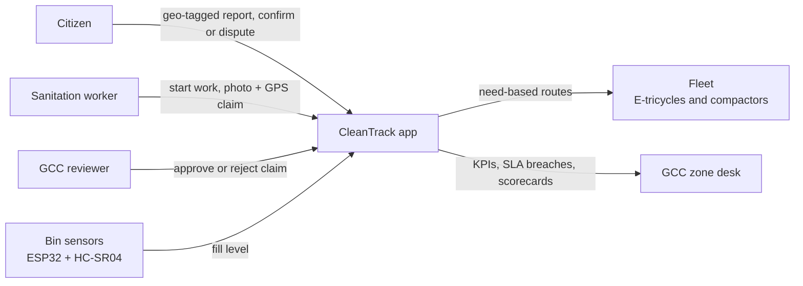
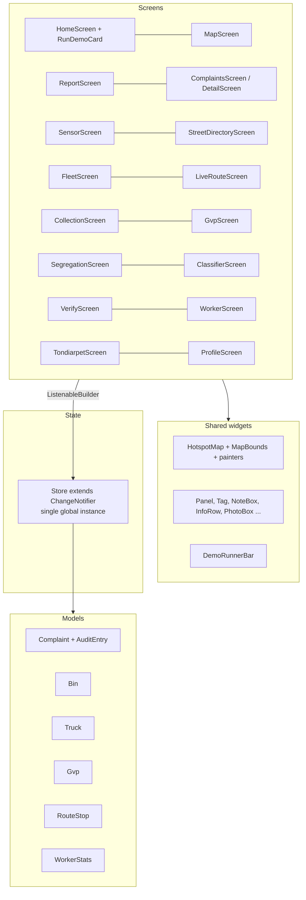
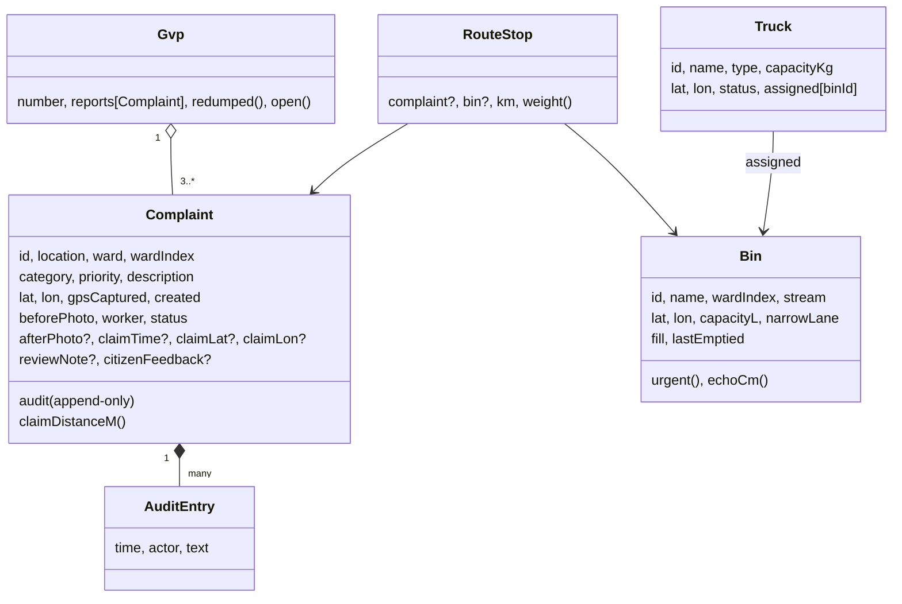
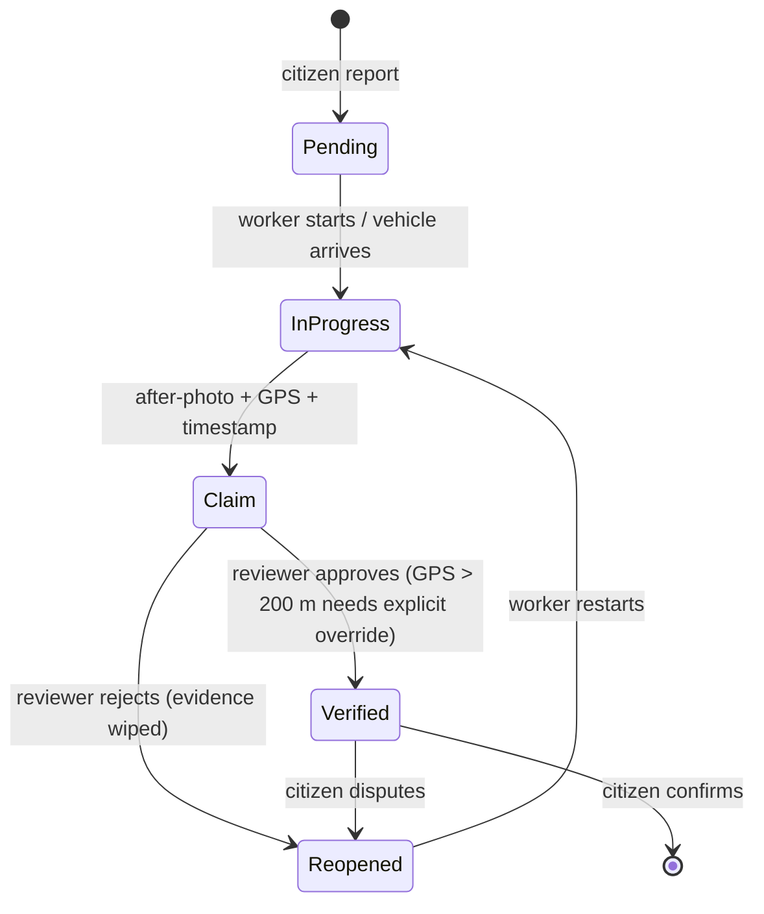
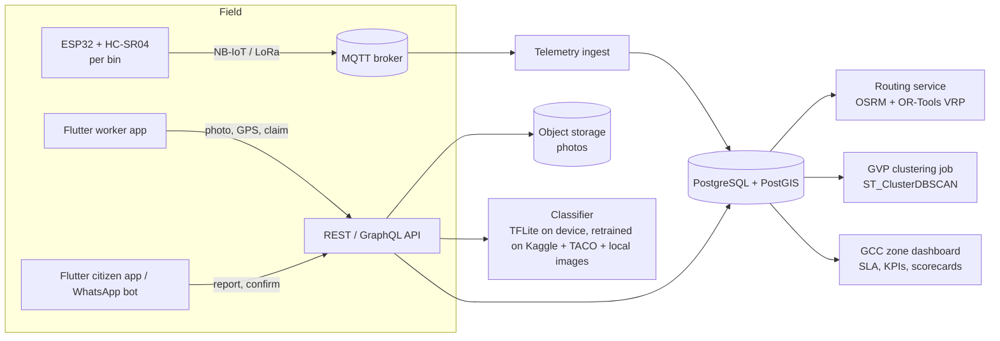

# CleanTrack Chennai: Architecture

This document covers the prototype as built (a single Flutter file) and the production design it maps to.

## 1. System context



In the prototype, sensors, GPS, photos and the fleet are simulated inside the app.

## 2. Prototype structure (`lib/main.dart`)

The app is one file so that it runs in DartPad. It is organised in layers:



| Layer | Main types | Responsibility |
|---|---|---|
| Models | `Complaint`, `AuditEntry`, `Bin`, `Truck`, `Gvp`, `RouteStop`, `WorkerStats`, enums `Status`, `Category`, `WasteStream`, `Priority`, `TruckType`, `TruckStatus` | Plain data and derived getters (`urgent`, `echoCm`, `claimDistanceM`, `reworkRate`) |
| State | `Store` (global `store`) | Seeds demo data and owns every mutation: reports, claims, approvals, sensor readings, dispatch, routes, demo-runner state. Calls `notifyListeners()` after each change |
| Algorithms | `haversineM`, `Store.gvps`, `Store._greedy`, `Store.routeFor`, `Store.fixedRouteKm`, `Store.segregationScore`, `Store.statsFor` | See section 4 |
| UI | One widget per screen; `HotspotMap` draws everything spatial | Reads from `store`, calls `store` methods; never mutates models directly |
| Demo runner | `runFullDemo()`, `DemoRunnerBar`, `navKey` | Drives the 11-step walkthrough across screens through the global navigator key |

## 3. Data model



### Complaint lifecycle



Workers can never move a complaint to **Verified**; only a reviewer can. Every transition appends an `AuditEntry`, and `Complaint.audit` is exposed as an unmodifiable list.

## 4. Algorithms

### 4.1 Distance

`haversineM` gives the great-circle distance in metres (Earth radius 6,371 km). All routing distances in the prototype are straight-line distances.

### 4.2 Chronic GVP detection

1. Take complaints created in the last `kGvpWindowDays` (30) days.
2. Union-find: join any two complaints within `kGvpRadiusM` (150 m).
3. Each connected group with at least `kGvpMinReports` (3) complaints is a GVP.
4. `redumped` counts reports in the group that were verified as cleaned before the latest report arrived.

The cost is O(n²) pairwise; that's fine for a ward-level demo. In production, use a PostGIS `ST_ClusterDBSCAN(geom, eps := 150, minpoints := 3)` query per ward, on geometry in a metre-based projection such as UTM 44N.

### 4.3 Bin sensors

Simulated HC-SR04 echo: `echoCm = 120 × (1 − fill/100)`. A bin is **urgent** when `fill >= threshold`, with the threshold selectable at 60/75/85/95%. Crossing the threshold writes an `[ALERT]` line to the sensor log. An *Overflowing bin* complaint sets the nearest bin (within 1 km) to 100%.

### 4.4 Need-based routing (greedy priority + proximity)

```
stops = open complaints + urgent bins   (optionally one waste stream)
from current position, repeatedly pick the stop with the lowest
    score = (distance_km + 0.5) / weight
    weight: complaint priority high 3 / medium 2 / low 1;
            bin 3 if 100% full, else 2
```

The `+ 0.5` stops a very close low-priority stop from always beating a slightly farther urgent one.

`routeFor(truck)` adds vehicle rules:
- **E-tricycle:** only Zone 4 (Tondiarpet) stops, including narrow lanes.
- **Compactor:** every other ward and **never** a narrow-lane bin.
- `assignTruck` refuses a narrow-lane assignment to a non-tricycle and any assignment to a vehicle under maintenance.

**Baseline for savings:** `fixedRouteKm()` is one truck visiting all 20 bins in fixed ward order from the depot, whether they are full or not.

With the seed data (verified by tests): fixed **77.34 km**, need-based **43.90 km** over 18 stops. That is about 33.4 km and about 11.7 L of diesel saved per trip at an assumed 0.35 L/km.

### 4.5 Segregation score and worker scorecard

- `segregationScore(ward) = 1 − mixedReports / allReports`. Below 0.6, the ward is flagged for an awareness drive.
- `statsFor(worker)` is computed from the audit log (claims, approvals, rejections, disputes, GPS flags). `reworkRate = (rejected + disputed) / claims`.

## 5. The 11-step demo runner

`runFullDemo()` is an `async` function with a 2.4 s delay between steps. It uses `navKey` to show the relevant screen and a token so **Stop** or **Reset** cancels it cleanly.

| # | Step | Store calls |
|---|---|---|
| 1 | Initialize | `seed()`, CHN-TND-01 set to 62% |
| 2 | Sensor breach | `setFill(CHN-TND-01, 98)` on the Sensor screen |
| 3 | Telemetry alert | sensor log entry; Fleet screen |
| 4 | Fleet allocation | `assignTruck(TRK-ET-01, CHN-TND-01)` |
| 5 | Route optimisation | `startRoute(TRK-ET-01)`; Live Route screen |
| 6 | Truck movement | `advanceRoute()`; complaint goes In Progress |
| 7 | Arrival and collection | `advanceRoute()`; bin emptied (0%) |
| 8 | Worker evidence claim | `submitClaim()` about 15 m from the site |
| 9 | Reviewer verification | `approve()` |
| 10 | Citizen confirmation | `confirmByCitizen()` |
| 11 | Audit trail | final audit log entry |

## 6. Production architecture



| Concern | Production choice |
|---|---|
| Identity | GCC SSO / OTP; roles: citizen, worker, supervisor, reviewer |
| Evidence integrity | Server timestamp; EXIF + device GPS; photo hash stored in the audit row; audit table insert-only, enforced by a database trigger |
| Routing | Road distances from OSRM on OpenStreetMap; capacity- and time-window-aware VRP (OR-Tools); separate fleets for narrow lanes |
| GVPs | Nightly DBSCAN per ward; GVPs become their own entities with prevention tasks |
| Privacy | Citizen identity hidden from workers; precise GPS shown only to staff |
| Scale | About 200 wards, 15 zones; per-zone routing; telemetry about every 30 min per bin |

## 7. Open datasets for the production build

| Dataset | Use | Notes |
|---|---|---|
| Kaggle Waste Classification Data (techsash) | Organic vs recyclable image classifier | About 22.5k training and 2.5k test images, 2 classes. No sanitary or C&D classes, so collect local images |
| TACO: Trash Annotations in Context | Litter detection / segmentation | 1,500 images, about 4,784 annotations, 60 categories |
| OpenStreetMap (Chennai) | Road graph for OSRM routing | ODbL licence |
| Chennai ward boundaries (e.g. DataMeet Municipal Spatial Data; GCC ward map on OpenCity) | Place collection points in their real wards | Check the licence of the version you use |
